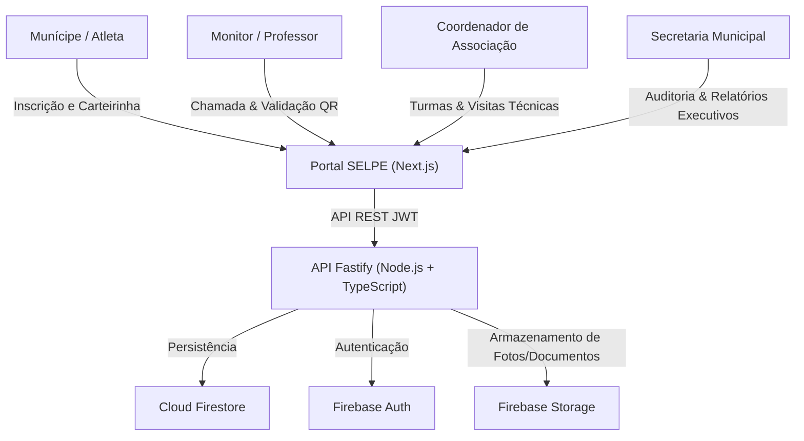

# 🏆 SELPE — Sistema de Esportes e Lazer de Peruíbe

> Plataforma integrada de gestão esportiva pública municipal para a **Secretaria de Esportes e Lazer da Prefeitura Municipal de Peruíbe/SP**.

O **SELPE** centraliza o gerenciamento de modalidades esportivas, turmas, matrículas de munícipes, controle de frequência presencial de atletas (com suporte a contingência offline), validação criptográfica de carteirinhas digitais via QR Code, monitoramento de associações parceiras e auditoria executiva municipal.

---

## 📋 Sumário

- [Visão Geral e Arquitetura](#-visão-geral-e-arquitetura)
- [Funcionalidades Principais por Perfil](#-funcionalidades-principais-por-perfil)
- [Tecnologias Utilizadas](#-tecnologias-utilizadas)
- [Estrutura do Repositório](#-estrutura-do-repositório)
- [Como Rodar o Projeto](#-como-rodar-o-projeto)
  - [Pré-requisitos](#pré-requisitos)
  - [Passo a Passo Rápido](#passo-a-passo-rápido)
  - [URLs e Portas dos Serviços](#urls-e-portas-dos-serviços)
- [Credenciais Pré-configuradas para Testes](#-credenciais-pré-configuradas-para-testes)
- [Principais Regras de Negócio e Segurança](#-principais-regras-de-negócio-e-segurança)
- [Endpoints da API Backend](#-endpoints-da-api-backend)

---

## 🏛️ Visão Geral e Arquitetura

O sistema conecta quatro atores essenciais na administração esportiva da cidade:



---

## 🌟 Funcionalidades Principais por Perfil

### 🔴 1. Aluno / Atleta (`/aluno`)
* **Cadastro Municipal com Proteção a Menores**:
  * Munícipes com 18 anos ou mais têm acesso imediato ao painel.
  * Menores de 18 anos têm a inscrição bloqueada até a validação expressa do responsável legal por meio de um link seguro e tokenizado enviado por WhatsApp.
* **Carteirinha Digital do Atleta**:
  * Emissão de carteirinha oficial com foto, matrícula única anual, modalidade e QR Code de segurança assinado com hash SHA-256.
  * Botão de salvar/imprimir apenas a carteirinha (recorte exato do documento sem poluição da interface).
* **Gestão de Perfil**:
  * Upload de foto de perfil com moderação e persistência.
  * Escolha e acompanhamento de modalidades matriculadas.

### 🟢 2. Monitor / Professor (`/professor`)
* **Quadro de Aulas & Minhas Turmas**:
  * Horários, dias da semana, locais e capacidade de vagas das turmas atribuídas ao professor.
* **Controle de Frequência Inteligente (Chamada)**:
  * Registro de presença por turma e data com lógica de **upsert** (atualiza a aula do dia, evitando duplicações).
  * Exibição clara de atletas aptos e aviso destacado para matrículas com aprovação pendente do responsável.
  * **Contingência Offline**: Caso a rede caia, a chamada é gravada localmente com deduplicação automática e sincronizada assim que a conexão retornar.
* **Validador de Carteirinha Digital**:
  * Validação em tempo real via câmera ao vivo (leitor de QR Code integrado via canvas), upload de imagem ou colagem direta (`Ctrl + V`).
  * Modal para visualização instantânea da carteirinha oficial de qualquer atleta da turma.

### 🔵 3. Coordenador de Associação (`/coordenador`)
* **Gestão de Modalidades & Grade Horária**:
  * Acompanhamento de horários das aulas sob responsabilidade de sua associação.
* **Check-in de Visitas Técnicas em Campo**:
  * Registro de vistorias técnicas periódicas nas unidades esportivas com geolocalização e upload de fotos comprobatórias.
* **Relatórios Oficiais em PDF**:
  * Geração instantânea de relatório de visitas técnicas em formato PDF para prestação de contas.

### 🟡 4. Secretaria de Esportes (`/secretaria`)
* **Auditoria Global e Visão Executiva**:
  * Monitoramento centralizado de todas as associações, turmas e professores do município.
  * Alternância dinâmica de visões (Modo Coordenador e Modo Monitor).
  * Relatórios executivos consolidados e matriz histórica de presença.

---

## 🛠️ Tecnologias Utilizadas

### Frontend
* **Next.js 16** (App Router, Turbopack) & **React 19**
* **TypeScript** para tipagem estrita de componentes e serviços
* **CSS Nativo Modular** baseado nos tokens oficiais do Wireframe da Prefeitura de Peruíbe
* **Lucide React** (biblioteca de ícones moderna)
* **jsQR** para decodificação rápida de QR Codes no navegador
* **HTML5 MediaStream API** para leitor de vídeo por webcam/câmera móvel

### Backend
* **Node.js 20+** com **Fastify v5** (alta performance e baixo overhead)
* **TypeScript** com build via **tsup** e execução com **tsx**
* **Fastify Type Provider Zod** para validação contratual estrita de schemas em runtime
* **Firebase Admin SDK** (Firestore Emulator, Firebase Auth Emulator, Storage Emulator)
* **Fastify JWT** com controle de acesso baseado em papéis (RBAC)
* **PDFKit** para geração dinâmica de relatórios em PDF com layout municipal
* **NSFWJS** & **Sharp** para processamento e moderação de uploads

### Infraestrutura & DevOps
* **Docker & Docker Compose** para orquestração de contêineres locais
* **Firebase Emulator Suite** com UI administrativa local

---

## 📁 Estrutura do Repositório

```text
selpe-system/
├── backend/
│   ├── docker/                 # Dockerfiles para dev e emulador Firebase
│   ├── src/
│   │   ├── modules/            # Módulos de domínio (auth, chamadas, matriculas, turmas, etc.)
│   │   ├── shared/             # Middlewares, utilitários, tratamento de erros e conexões
│   │   ├── config/             # Validação de variáveis de ambiente com Zod
│   │   ├── app.ts              # Configuração dos plugins Fastify
│   │   ├── seed.ts             # Script de população do banco de dados de desenvolvimento
│   │   └── server.ts           # Inicialização do servidor HTTP
│   └── package.json
├── frontend/
│   ├── app/
│   │   ├── aluno/              # Páginas de login e dashboard do munícipe/atleta
│   │   ├── professor/          # Páginas de login e dashboard do monitor/professor
│   │   ├── coordenador/        # Gestão da associação esportiva parceira
│   │   ├── secretaria/         # Portal executivo da prefeitura
│   │   ├── cadastro/           # Formulário de inscrição de munícipes
│   │   ├── components/         # CarteirinhaDigital, BrasiliaClock, etc.
│   │   ├── services/           # Cliente HTTP da API
│   │   └── styles/             # Folhas de estilo temáticas e globais
│   └── package.json
├── docker-compose.yml          # Orquestração do Backend e Emuladores
└── README.md                   # Documentação do projeto
```

---

## 🚀 Como Rodar o Projeto

### Pré-requisitos
* [Docker](https://www.docker.com/) e [Docker Compose](https://docs.docker.com/compose/) instalados.
* [Node.js](https://nodejs.org/) versão 20 ou superior.
* Gerenciador de pacotes `npm`.

---

### Passo a Passo Rápido

#### 1. Iniciar os serviços do Backend e Firebase Emulator
Na raiz do repositório, suba os contêineres:

```bash
docker compose up -d
```

#### 2. Executar o Seed com os dados pré-configurados
Popule o banco do emulador com os usuários, associações, turmas e modalidades iniciais:

```bash
docker compose exec backend npm run seed
```

*(Opcional: se preferir rodar o seed via terminal local, execute `cd backend && npm run seed`)*.

#### 3. Instalar e iniciar o Frontend
Em outro terminal, acesse a pasta do frontend e execute:

```bash
cd frontend
npm install
npm run dev
```

Pronto! A aplicação estará disponível em `http://localhost:3000`.

---

### 🌐 URLs e Portas dos Serviços

| Serviço | URL | Descrição |
| :--- | :--- | :--- |
| **Frontend Web** | [http://localhost:3000](http://localhost:3000) | Aplicação web principal Next.js |
| **Backend API** | [http://localhost:3333](http://localhost:3333) | API REST Fastify |
| **Documentação Swagger** | [http://localhost:3333/documentation](http://localhost:3333/documentation) | Documentação interativa OpenAPI |
| **Firebase Emulator UI** | [http://localhost:4005](http://localhost:4005) | Painel visual do Firestore, Auth e Storage |
| **Firestore Emulator** | `localhost:8085` | Porta de conexão do Firestore |
| **Auth Emulator** | `localhost:9095` | Porta de conexão do Firebase Auth |
| **Storage Emulator** | `localhost:9195` | Porta de conexão do Firebase Storage |

---

## 🔑 Credenciais Pré-configuradas para Testes

O banco inicial já vem com usuários de teste prontos para uso em todos os fluxos:

| Perfil | Identificador / Login | Senha | Detalhes / Papel | Rota de Acesso |
| :--- | :--- | :--- | :--- | :--- |
| **Aluno / Atleta** | `aluno` ou `000.000.000-00` | `123456` ou `1234` | Matrícula: `2026-000001` (Futebol) | [`/aluno/login`](http://localhost:3000/aluno/login) |
| **Professor / Monitor** | `professor` | `123456` ou `1234` | Código: `PROF001` (Unidade Central) | [`/professor/login`](http://localhost:3000/professor/login) |
| **Monitor (Pedro)** | `pedro` ou `333.333.333-33` | `123456` | Código: `PROF002` (Amigos do Bem) | [`/professor/login`](http://localhost:3000/professor/login) |
| **Coordenador** | `coordenador` | `123456` | Augusto Figueiredo (Amigos do Bem) | [`/coordenador/login`](http://localhost:3000/coordenador/login) |
| **Secretaria de Esportes** | `secretaria` | `123456` | Gestão Global da Prefeitura | [`/secretaria/login`](http://localhost:3000/secretaria/login) |
| **Administrador Geral** | `admin` | `senhaSegura123` | CPF: `52998224725` | [`/secretaria/login`](http://localhost:3000/secretaria/login) |

---

## 🔒 Principais Regras de Negócio e Segurança

1. **Horário Oficial de Brasília (UTC-3)**:
   * Todo o sistema opera sincronizado no fuso horário `America/Sao_Paulo`. Chamadas em datas futuras são estritamente rejeitadas pelo backend.
2. **Proteção à Criança e ao Adolescente (ECA / LGPD)**:
   * O cadastro de menores de 18 anos gera um token de segurança de 7 dias e aguarda confirmação explícita do pai ou mãe por rota dedicada (`/responsavel/[token]`).
   * Atletas com cadastro pendente não podem receber presenças oficiais em chamadas diárias até a regularização.
3. **Carteirinha Digital Anti-Falsificação**:
   * O payload do QR Code contém um hash SHA-256 gerado a partir de chave secreta com dados imutáveis da matrícula.
   * O validador confirma a autenticidade diretamente contra o backend e indica visualmente se a credencial é válida, expirada ou inexistente.
4. **Chamadas Idempotentes & Offline-First**:
   * Cada aula possui apenas um registro diário por turma. Múltiplos envios atualizam o mesmo documento (**upsert**).
   * A fila offline deduplica registros e só é ativada em caso de falha de conexão real.

---

## 📡 Endpoints da API Backend

Para consultar parâmetros, contratos e testar requisições em tempo real, acesse o **Swagger UI** em `http://localhost:3333/documentation`. Alguns dos principais endpoints incluem:

* `POST /auth/login` — Autenticação de usuários (munícipe, professor, coordenador, secretaria)
* `POST /auth/register` — Inscrição de novos atletas
* `POST /auth/me/foto` — Upload e persistência da foto de perfil
* `GET  /matriculas/carteirinha/:alunoId` — Dados e hash criptográfico da carteirinha digital
* `POST /matriculas/carteirinha/validar` — Validação oficial do QR Code da carteirinha
* `GET  /chamadas` — Consulta de lista de chamada por turma e período
* `POST /chamadas` — Registro/atualização de chamada da turma (com validação de alunos ativos)
* `POST /chamadas/sync` — Sincronização em lote de registros offline com proteção contra adulteração de relógio
* `GET  /relatorios/frequencia/pdf` — Geração do relatório oficial de frequência em formato PDF
* `POST /checkins` — Check-in de visita técnica de coordenadores de associação

---

Desenvolvido para a **Secretaria de Esportes e Lazer — Prefeitura de Peruíbe/SP**.
